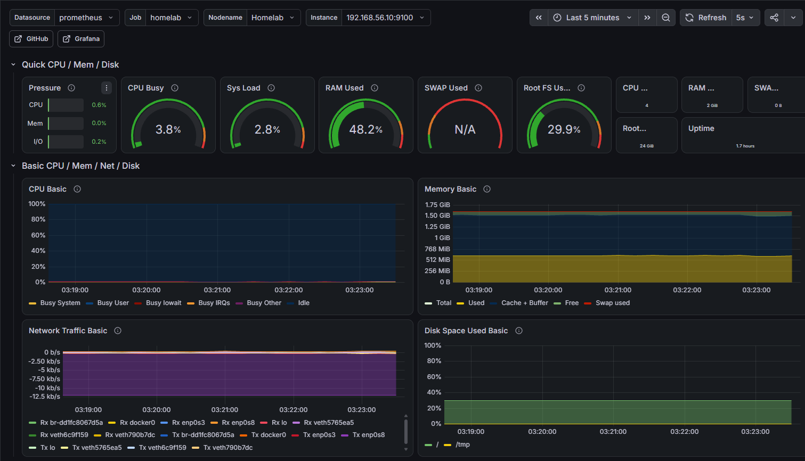

# Linux Homelab

This is a personal homelab project I built to get more hands-on experience with Linux, networking, Docker, and server monitoring.

I used VirtualBox to set up two Ubuntu Server virtual machines. One runs a web application using Docker, while the other monitors the server using Prometheus and Grafana.

The application itself is my bachelor's project, which I had previously developed. For this homelab, I wanted to focus on deploying it to a Linux server, configuring the network, and monitoring how everything runs.

## Setup

The homelab consists of two Ubuntu Server virtual machines running in VirtualBox.

| Server | IP address | Purpose |
|---|---|---|
| Homelab | `192.168.56.10` | Runs the application and Node Exporter |
| Monitoring | `192.168.56.20` | Runs Prometheus and Grafana |

Both VMs use a NAT adapter for internet access and a Host-Only adapter to communicate with each other and the Windows host.

## Technologies Used

- **Ubuntu Server** — operating system for both VMs
- **VirtualBox** — virtualization
- **Docker & Docker Compose** — running the application containers
- **PostgreSQL** — application database
- **Nginx** — serving the React frontend
- **Prometheus** — collecting server metrics
- **Node Exporter** — exposing Linux system metrics
- **Grafana** — displaying metrics in dashboards
- **UFW** — configuring firewall rules
- **SSH** — accessing and managing the servers remotely

## What I Did

- Installed and configured two Ubuntu Server VMs.
- Set up static IP addresses and networking between the VMs.
- Configured SSH access and firewall rules.
- Deployed my bachelor's application using Docker Compose.
- Set up Node Exporter, Prometheus, and Grafana.
- Created a dashboard to monitor CPU, RAM, disk usage, and network activity.
- Tested the monitoring setup by generating a temporary CPU workload.

## Problems I Ran Into

While deploying the application, I ran into issues with CORS configuration and JWT authentication. I checked the backend logs, updated the configuration, and rebuilt the application to get everything working.

I also encountered CPU soft-lockup warnings while running the Ubuntu VMs in VirtualBox. After checking the VM logs, I found that VirtualBox was using the Windows hypervisor through NEM (Native Execution Manager). This could explain the performance issues, but I haven't confirmed it yet. I decided to leave the configuration unchanged for now because I also use Docker Desktop on Windows.

## Screenshots

### Grafana Dashboard

This dashboard shows CPU, memory, disk, and network usage from the Homelab server. The metrics are collected by Prometheus using Node Exporter.

